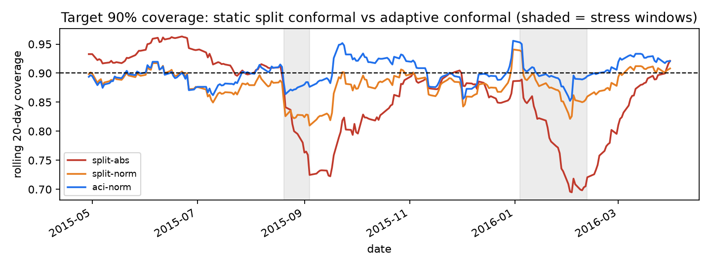

# TrustBand

**Calibrated prediction intervals that stay honest under distribution shift and adversarial text.**

TrustBand predicts a 90% range for each stock's next-day return from price history plus tweets, and keeps
that range meaningful when markets panic or when bots flood social media. It combines FinBERT sentiment,
a per-post trust score, LightGBM, and adaptive conformal prediction.

Built for the [Perceptron Hackathon 2026](https://techfest.org) (IITB–Optiver AI Innovation Lab, Techfest IIT
Bombay), Problem 10: *"Trusting a signal extracted from messy, manipulated text"*. Selected for the Round 2 finals.



## Key findings

All numbers come from `results/` and are reproduced by the three scripts below (88 US stocks, trained on
2014, tested April 2015 – March 2016, 21,924 stock-days).

1. **Standard conformal prediction breaks under distribution shift.** A static split-conformal 90% band
   covered only **61.8%** of outcomes during the August 2015 crash. Adaptive conformal inference (ACI) held
   **85.1%** in the crash and **90.2%** overall, for bands ~5% wider.
2. **Text predicts uncertainty, not direction.** Tweet sentiment has ≈0 rank correlation with next-day
   returns (−0.016), but on the top 5% abnormal-attention days the next move is **+16%** larger than the
   stock's normal move (95% CI 10–23%), or **+20%** with trust-weighted attention (CI 12–28%).
3. **"Valid" is not "meaningful".** Injecting coordinated bot posts into 10% of stock-days inflated a naive
   fusion model's bands by **23%** while coverage stayed above 90%: the bound looked fine but carried a fake
   volatility signal. Trust-weighting cut the inflation to **0.6%**. Bots disguised as real users still
   caused **+17%**, which is the open problem.
4. **The raw text is hostile by default:** 55% of the 119,641 tweets come from automated clients and 40%
   are near-duplicates.

## How it works

```
tweets ──► FinBERT sentiment ──┐
       └─► per-tweet trust w ──┴─► daily text features (trust-weighted) ─┐
prices ──► price features ───────────────────────────────────────────────┴─► LightGBM: ŷ and error size σ̂(x)
                                                                                   │
                     band = ŷ ± q·σ̂(x),  q updated daily by ACI, separate q per trust bucket
                                                                                   │
                                               next day's real return ──► hit / miss ──► updates q
```

- **Leakage guard:** each tweet counts toward the first 16:00 New York close at or after it; splits are
  strictly walk-forward; FinBERT (a polarity classifier) is used instead of a chat LLM that has read later news.
- **Error-size model:** σ̂(x) is trained on out-of-fold residuals so the bands are not too narrow.
- **ACI** ([Gibbs & Candès, 2021](https://arxiv.org/abs/2106.00170)): after each day,
  α ← α + γ(0.10 − miss rate), so the band widens when it misses too often.
- **Mondrian buckets:** high- and low-trust days keep separate error histories, so coverage holds within
  suspicious days, not just on average.

## Results

**E1: coverage under regime shift** (naive fusion model, 90% target)

| Method | Overall | Aug-15 crash | Jan-16 sell-off | Worst 20 days | Median width |
| --- | --- | --- | --- | --- | --- |
| Split conformal, raw errors | 86.7% | 61.8% | 71.9% | 69.5% | 4.60% |
| Split conformal, normalised | 88.2% | 76.0% | 84.1% | 81.0% | 4.54% |
| **Adaptive conformal (ACI)** | **90.2%** | **85.1%** | **87.2%** | **85.2%** | 4.85% |

**E3: manipulation** (10% of test stock-days attacked, median band width on attacked vs clean days)

| Attacker | Model | Width inflation | Coverage on attacked days |
| --- | --- | --- | --- |
| Bot flood | Naive fusion | +22.8% | 94.3% |
| Bot flood | Trust-weighted | +0.6% | 90.6% |
| Stealth (aged accounts, unique text) | Trust-weighted | +17.4% | 93.8% |

Full tables: [`results/e1_e2.csv`](results/e1_e2.csv), [`results/e3_attack.csv`](results/e3_attack.csv),
[`results/stats.json`](results/stats.json).

## Quickstart

Python 3.10+; an NVIDIA GPU is optional (FinBERT scoring takes about a minute on an RTX 4050).

```bash
python -m venv .venv
.venv/Scripts/activate            # Windows; on Linux/macOS: source .venv/bin/activate
pip install torch --index-url https://download.pytorch.org/whl/cu126   # or the CPU build
pip install -e ".[app,dev]"

python scripts/01_build_dataset.py      # downloads StockNet (~100 MB) and builds data/processed/
python scripts/02_score_sentiment.py    # FinBERT sentiment for every unique tweet
python scripts/03_run_experiments.py    # E1-E3, writes results/
pytest                                  # conformal + leakage sanity tests
```

All settings (dates, α, γ, trust penalties, attack sizes) live in [`configs/default.yaml`](configs/default.yaml).

## Repository layout

```
configs/default.yaml     every experiment setting
src/trustband/
  data.py                StockNet loading + 16:00 ET trading-day alignment
  sentiment.py           FinBERT scoring (deduplicated)
  trust.py               per-tweet trust weights
  features.py            price and (trust-weighted) text features
  models.py              LightGBM forecast + out-of-fold error-size model
  conformal.py           split / adaptive / per-bucket conformal bands
  attacks.py             pump-and-dump injection
  evaluate.py            coverage, width, rank correlation, bootstrap CIs
scripts/                 01 build data → 02 sentiment → 03 experiments
tests/                   synthetic coverage checks + leakage checks
docs/abstract/           Round 1 abstract (LaTeX)
```

## Limitations

- One walk-forward split; settings (γ, window, trust penalties) were fixed by hand before testing.
- The trust score is a hand-written heuristic; it fails against disguised bots (+17%).
- FinBERT was trained on news and misreads social-media hype (e.g. "short squeeze incoming" scores neutral).
- Attacks inject text only; prices are untouched, so this measures the effect of fake buzz alone.

## Roadmap

- [ ] MAPIE split-conformal baseline; calibration check at 80/90/95%; multiple seeds
- [ ] Learned trust model (weak labels → LightGBM) with coordination features
- [ ] LLM-paraphrased attacks (Groq) and noisy-label tests
- [ ] FNSPID news data for a second, out-of-domain test
- [ ] Streamlit dashboard with a live "inject attack" slider

## Data and credits

- [StockNet](https://github.com/yumoxu/stocknet-dataset) — Xu & Cohen,
  [*Stock Movement Prediction from Tweets and Historical Prices*](https://aclanthology.org/P18-1183/), ACL 2018.
- [FinBERT](https://huggingface.co/ProsusAI/finbert) — Araci, [arXiv:1908.10063](https://arxiv.org/abs/1908.10063).
- Conformal prediction background: Angelopoulos & Bates, [*A Gentle Introduction to Conformal
  Prediction*](https://arxiv.org/abs/2107.07511).

Data is downloaded at run time and not redistributed here. Code is MIT-licensed.
